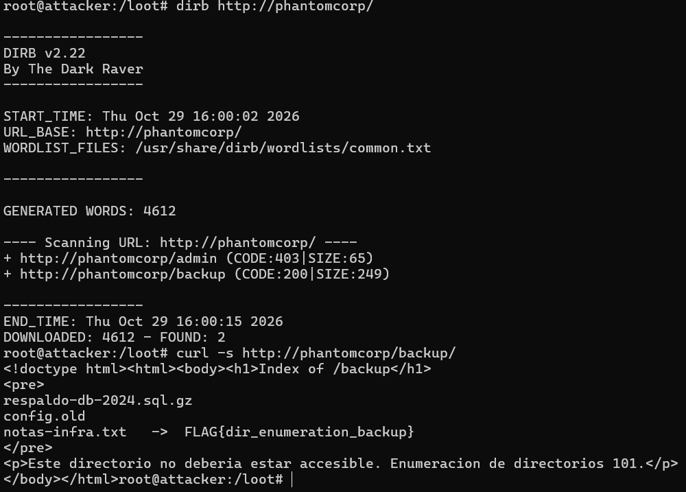
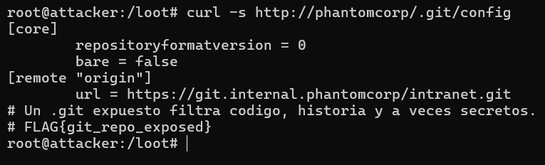
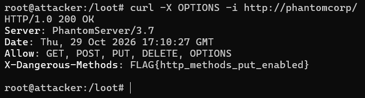
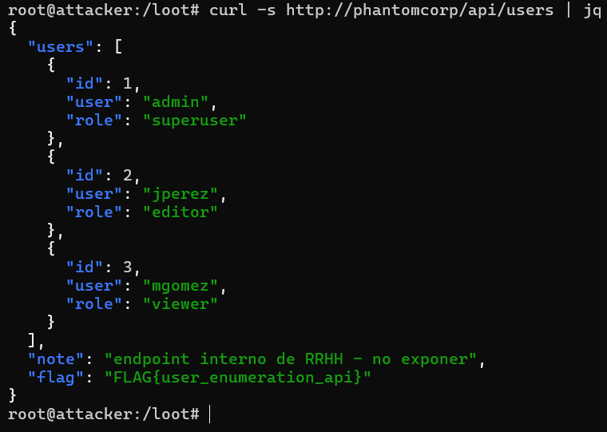
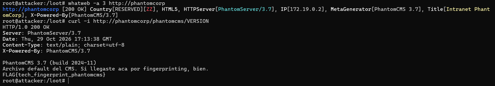
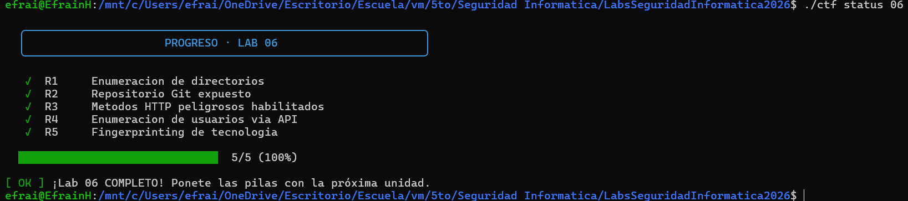

# Laboratorio 06 — Enumeración de servicios

**Grupo:** 03  
**Objetivo autorizado:** PhantomCorp, entorno de laboratorio de la cátedra  
**Herramientas:** `dirb`, `curl`, `whatweb` y `jq`

## 1. Objetivo

El objetivo fue enumerar los recursos y servicios expuestos por PhantomCorp, identificar configuraciones inseguras y analizar cómo los hallazgos podrían orientar una fase posterior de explotación.

A diferencia del reconocimiento general realizado en el Lab 05, en este laboratorio se profundizó en recursos específicos del servidor web: directorios, archivos internos, métodos HTTP, endpoints de API y archivos asociados a la tecnología detectada.

## 2. Inventario de enumeración

### R1. Directorio de backup expuesto

- **Ruta:** `/backup`
- **Técnica:** enumeración de directorios con `dirb` y solicitud HTTP con `curl`.
- **Evidencia:** se encontró la flag `FLAG{dir_enumeration_backup}` al consultar el recurso.
- **Riesgo:** un directorio de respaldo accesible puede exponer copias de archivos, configuraciones o información que no debería ser pública. El impacto depende del contenido real del directorio.
- **Qué habilita para el Lab 07:** analizar los archivos expuestos para determinar si contienen información útil para identificar otros recursos o debilidades.
- **Evidencia:** salida real de `dirb` y respuesta HTTP del recurso encontrado.


### R2. Archivo de configuración Git expuesto

- **Ruta:** `/.git/config`
- **Técnica:** enumeración de archivos internos y solicitud HTTP con `curl`.
- **Evidencia:** la respuesta de `curl -s http://phantomcorp/.git/config` mostró la configuración del repositorio, una referencia al remoto `origin` y la flag `FLAG{git_repo_exposed}`.
- **Riesgo:** la exposición de archivos internos de Git puede revelar metadatos y direcciones del repositorio. Si también se puede acceder a los objetos y demás archivos necesarios, podría ser posible reconstruir el código y el historial de cambios, incluidos secretos que se hayan incorporado accidentalmente.
- **Qué habilita para el Lab 07:** comprobar si hay más componentes del repositorio accesibles y evaluar si la información expuesta revela configuraciones sensibles o secretos.
- **Evidencia:** salida completa de la solicitud HTTP a `/.git/config`.


### R3. Métodos HTTP potencialmente peligrosos

- **Ruta:** `/`
- **Técnica:** consulta de métodos HTTP con el método `OPTIONS`.
- **Evidencia:** `curl -X OPTIONS -i http://phantomcorp/` devolvió `Allow: GET, POST, PUT, DELETE, OPTIONS` y `X-Dangerous-Methods: FLAG{http_methods_put_enabled}`.
- **Riesgo:** si el servidor permite operaciones de escritura o eliminación sin controles adecuados, un atacante podría modificar recursos o cargar archivos. La cabecera `Allow` no demuestra por sí sola que esas operaciones puedan realizarse sin autorización.
- **Qué habilita para el Lab 07:** verificar, dentro del entorno autorizado, qué operaciones acepta realmente el servidor y si existen controles de acceso suficientes.
- **Evidencia:** salida completa de `curl -X OPTIONS -i http://phantomcorp/`.


### R4. API de usuarios expuesta

- **Ruta:** `/api/users`
- **Técnica:** enumeración de endpoints de API y análisis de la respuesta JSON con `curl` y `jq`.
- **Evidencia:** `curl -s http://phantomcorp/api/users | jq` devolvió tres registros:
  - `admin`, con rol `superuser`.
  - `jperez`, con rol `editor`.
  - `mgomez`, con rol `viewer`.

  La respuesta también incluía la nota `endpoint interno de RRHH - no exponer` y la flag `FLAG{user_enumeration_api}`.
- **Riesgo:** la exposición de usuarios y roles permite identificar cuentas válidas y priorizar objetivos. Esa información puede facilitar ataques dirigidos o la búsqueda de fallas en los controles de autorización.
- **Qué habilita para el Lab 07:** evaluar si los endpoints restringen correctamente el acceso y si la información de cada usuario está disponible solamente para los roles autorizados.
- **Evidencia:** salida JSON completa de la solicitud.


### R5. Fingerprinting de tecnología

- **Objetivo:** identificar el CMS y su versión, y utilizar esa información para orientar la búsqueda de un archivo predeterminado.
- **Técnica:** fingerprinting web con `whatweb` y consulta HTTP del archivo identificado.
- **Evidencia del fingerprinting:** `whatweb -a 3 http://phantomcorp` identificó:
  - `HTTPServer[PhantomServer/3.7]`
  - `MetaGenerator[PhantomCMS 3.7]`
  - `X-Powered-By[PhantomCMS/3.7]`
  - `Title[Intranet PhantomCorp]`
- **Flag:** `FLAG{tech_fingerprint_phantomcms}`
- **Riesgo:** conocer el producto y su versión permite investigar debilidades y archivos predeterminados asociados a esa tecnología. La identificación no demuestra, por sí sola, que exista una vulnerabilidad explotable.
- **Qué habilita para el Lab 07:** investigar los riesgos de la versión detectada y comprobar si existen otros archivos o configuraciones expuestos.
- **Evidencia:** salida real de la consulta HTTP al archivo predeterminado y flag obtenida.


## 3. Preguntas de análisis

### P1. Diferencia entre reconocimiento y enumeración

El reconocimiento busca obtener una visión general del objetivo y determinar qué servicios están disponibles. La enumeración profundiza en esos servicios para identificar recursos, información y configuraciones concretas.

En el Lab 05 se utilizaron `nmap` para descubrir puertos abiertos y técnicas de banner grabbing con `ncat` para identificar servicios. También se inspeccionaron cabeceras HTTP y rutas conocidas.

En el Lab 06 se profundizó en el servidor web con `dirb` para descubrir directorios, `whatweb` para identificar el CMS y solicitudes HTTP a rutas concretas como `/.git/config` y `/api/users`.

Por lo tanto, el reconocimiento permitió mapear la superficie de exposición, mientras que la enumeración permitió identificar recursos específicos y analizar los riesgos asociados.

### P2. ¿Qué podría reconstruir un atacante con un `.git` expuesto y por qué es más grave que un archivo adicional?

El archivo `/.git/config` puede revelar información de configuración del repositorio, como la dirección de un remoto. Sin embargo, exponer únicamente ese archivo no demuestra que se pueda reconstruir todo el repositorio.

Si el directorio `.git` completo y sus objetos son accesibles, un atacante podría reconstruir el código fuente y consultar el historial de cambios. Esto podría revelar rutas internas, detalles de implementación y secretos que se hayan incluido accidentalmente y no se hayan eliminado del historial.

Por eso, el riesgo potencial va más allá de la exposición de un archivo aislado: puede permitir obtener información sobre el desarrollo y la configuración de la aplicación. La magnitud del impacto depende de qué componentes del repositorio estén realmente accesibles.

### P3. Describí un ataque concreto que aproveche PUT.

Si un servidor acepta solicitudes `PUT` sin autorización adecuada, un atacante podría intentar cargar un archivo en una ubicación escribible. Si además ese archivo queda accesible desde la web y el servidor permite ejecutarlo, la situación podría facilitar la ejecución de código o la alteración del contenido publicado.

En este laboratorio se observó que `PUT` figuraba entre los métodos anunciados por el servidor. Esto justifica investigar la configuración, pero no demuestra por sí solo que sea posible cargar archivos arbitrarios.

### P4. ¿Por qué enumerar usuarios válidos es un problema aunque no se muestren contraseñas?

Conocer usuarios válidos permite distinguir cuentas existentes de cuentas inexistentes y priorizar objetivos para ataques dirigidos. Conocer los roles también ayuda a identificar cuentas privilegiadas.

En el caso del laboratorio, el endpoint expuso cuentas con los roles `superuser`, `editor` y `viewer`. Esa información puede facilitar intentos de acceso no autorizado, campañas de phishing o ataques de fuerza bruta dirigidos.

La exposición resulta especialmente importante para la fase siguiente porque proporciona información concreta sobre posibles objetivos. No obstante, la enumeración por sí sola no demuestra que las cuentas puedan ser comprometidas.

### P5. Mitigación concreta para tres hallazgos

**1. Repositorio Git expuesto**

- No desplegar el directorio `.git` en el directorio público del servidor.
- Denegar desde la configuración del servidor web las solicitudes a archivos y directorios internos.
- Revocar y reemplazar los secretos que pudieran haberse expuesto.

**2. Método PUT habilitado**

- Deshabilitar `PUT` si la aplicación no lo necesita.
- Si es necesario, permitirlo solamente en las rutas que lo requieran y exigir autorización.
- Restringir los tipos de archivos y las ubicaciones en las que se permite escribir.

**3. API de usuarios expuesta**

- Exigir autenticación y autorización en los endpoints que contienen información interna.
- Aplicar controles de acceso por rol en el servidor.
- Devolver solamente los datos necesarios y registrar accesos no autorizados.

## 4. Evidencias

Adjuntadas las salidas originales de las siguientes pruebas:

1. `dirb` y solicitud al recurso de backup.
2. Solicitud HTTP a `/.git/config`.
3. Solicitud `OPTIONS` a `/`.
4. Respuesta JSON de `/api/users`.
5. Salida de `whatweb` y solicitud al archivo predeterminado del CMS.

Incluir también una captura del comando:

```bash
./ctf status 06
```



## 5. Conclusión

La enumeración permitió identificar exposiciones relacionadas con directorios de respaldo, archivos internos de Git, métodos HTTP, información de usuarios y archivos predeterminados del CMS.

Los hallazgos muestran que la información expuesta puede facilitar las etapas posteriores de un ataque, incluso cuando no se encuentran contraseñas ni se demuestra una explotación completa. La mitigación requiere restringir los recursos internos, aplicar controles de autorización y evitar publicar información innecesaria.

## 6. Uso de herramientas de IA

Se utilizó una herramienta de inteligencia artificial como apoyo para organizar el informe, redactar las explicaciones de riesgo y estructurar las respuestas. Los hallazgos y las evidencias deben corresponder a las pruebas realizadas por el grupo en el entorno autorizado del laboratorio.

## Distribución del trabajo grupal

El trabajo del Laboratorio 06 se organizó en cuatro áreas, con el objetivo de distribuir las tareas de enumeración, análisis de riesgos, investigación y documentación.

- **Federico Sanchez — Enumeración de directorios y repositorios expuestos:** revisión y documentación de los hallazgos R1 y R2, relacionados con la enumeración de rutas y la exposición de `.git`, incluyendo sus evidencias y riesgos.
- **Host Efrain — Análisis de métodos HTTP y enumeración de usuarios:** documentación de R3 y R4, análisis de los métodos HTTP habilitados y del endpoint de usuarios, y descripción de los riesgos asociados.
- **Elian Enria — Investigación técnica:** desarrollo y revisión de `research.md`, centrado en las técnicas de fingerprinting pasivo y activo, la verificación de fuentes y la reflexión final.
- **Lohana Rumis — Fingerprinting e integración de la entrega:** revisión del hallazgo R5, verificación de las evidencias disponibles y revisión de la estructura general del informe y de las respuestas P1–P5.

**Integración final:** se consolidaron los documentos, las evidencias y las respuestas en la carpeta `entregas/lab06/grupo03/` para su entrega en la rama `lab06-grupo03`.
