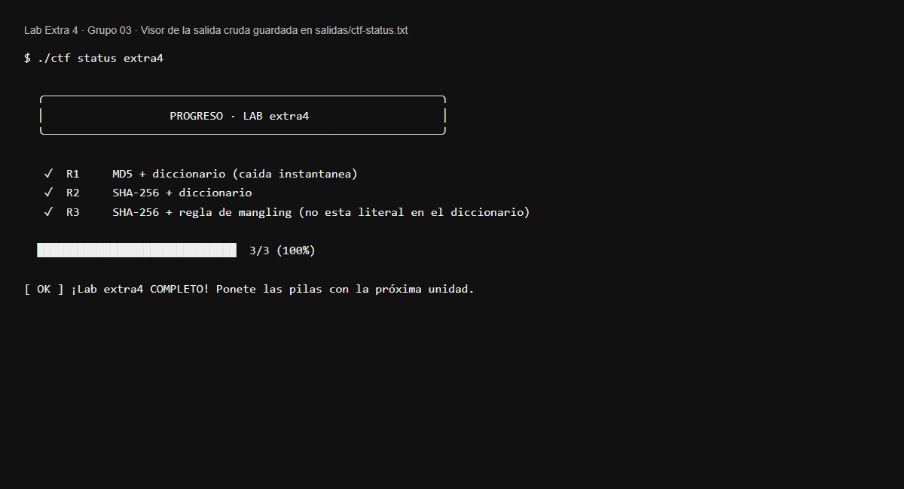

# Informe — Laboratorio Extra 4: Cracking de contraseñas

**Grupo:** 03 · **Materia:** Seguridad Informática · **Fecha:** 19/11/2026

| Integrante | Legajo | GitHub |
|---|---|---|
| Federico Sánchez | 13614 | @Fedesan14 |
| Elian Enria | 13245 | @elian-enria-id |
| Efraín Host | 18273 | @hostefrain |
| Lohana Rumis | 14646 | @Lohana-Rumis |

Integrantes tomados de la entrega existente del grupo 03 en el Lab 02.

**Declaración de uso de IA:** se utilizó OpenAI Codex para leer la consigna, implementar el cracker y los scripts auxiliares, ejecutar pruebas y ataques sobre el caso ficticio local, medir rendimiento, consultar fuentes y redactar el informe y el research. Los resultados provienen de ejecuciones reales guardadas como evidencia. No se atribuyen a los integrantes tareas, revisiones ni commits que no se hayan verificado. La entrega queda disponible para su revisión y defensa por el grupo.

## 1. Tabla de resultados

Se completaron las cuatro funciones del esqueleto en [cracker.py](cracker.py), conservando las firmas y la CLI y utilizando únicamente la biblioteca estándar. El caso original no se regeneró ni modificó. Se consultó `generar_caso.py` para confirmar la receta de hash y sus parámetros; los hallazgos se obtuvieron probando candidatos contra `sombra.txt`.

| Usuario | Algoritmo | ¿Cayó? | Técnica | Contraseña | Intentos y tiempo de la ejecución |
|---|---|---|---|---|---|
| operador | MD5 + salt | Sí, R1 | Diccionario literal | `riverplate` | 8; 0,000058 s |
| analista | SHA-256 + salt | Sí, R2 | Diccionario literal | `matecocido` | 11; 0,000032 s |
| admin | SHA-256 + salt | Sí, R3 | Regla: `phantom` + `2026` | `phantom2026` | 67 con reglas; 0,000118 s |
| root | PBKDF2-HMAC-SHA256, 200.000 iteraciones | No | Se agotaron los candidatos | No recuperada | 49 literales: 5,782754 s; 679 con reglas: 79,725718 s |

Fuentes de los tiempos: [diccionario.txt](evidencia/salidas/diccionario.txt) y [reglas.txt](evidencia/salidas/reglas.txt). Los tiempos son por cuenta, hasta la coincidencia o el agotamiento, sin incluir la lectura del diccionario ni la espera por cuentas anteriores. Con reglas también cayeron operador y analista, en 92 y 134 intentos respectivamente. Los submilisegundos de una sola corrida son ruidosos; para comparar algoritmos usamos tandas mayores en la sección 2.

El diccionario contiene **49 palabras**. Las reglas generan la palabra original y su variante con inicial mayúscula, combinadas con los sufijos `""`, `2024`, `2025`, `2026`, `1`, `12` y `123`. Se eliminan duplicados conservando el orden. Quedan **679 candidatos únicos**: `123456` no cambia al capitalizarse y aporta siete variantes en lugar de catorce. `phantom2026` no está literal en el diccionario y aparece en la posición 67 al expandirlo.

Para MD5/SHA-256 se calcula `H(bytes.fromhex(salt_hex) + password.encode("utf-8"))`. Para PBKDF2 se deriva un bloque de 32 bytes con HMAC-SHA256, el mismo salt y 200.000 iteraciones. No se concatena la representación textual hexadecimal como si fuera el salt original.

## 2. Medición de velocidad (P1)

Entorno registrado: **Windows 11, Python 3.13.15, OpenSSL 3.0.21**, CPU `AMD64 Family 23 Model 113 Stepping 0, AuthenticAMD`, 12 procesadores lógicos. El cracker y el benchmark usan **un hilo de CPU**, sin GPU.

Se ejecutó [medir.py](medir.py) con `time.perf_counter()`: tres tandas por algoritmo, tomando la mediana de duración. Para MD5 y SHA-256 se hicieron 100.000 intentos por tanda para reducir el ruido; para PBKDF2, 20. Los candidatos se preparan y la implementación se calienta antes del cronómetro. El bucle incluye la llamada a `hash_de()`, codificación, cálculo y conversión a hexadecimal, sin lecturas, impresiones ni comparaciones contra el hash objetivo.

```powershell
python -X utf8 entregas/labextra4/grupo03/medir.py labs/labextra4-cracking/caso/sombra.txt labs/labextra4-cracking/caso/diccionario.txt
```

| Algoritmo | Intentos por tanda | Mediana de la tanda | Intentos/s | 49 candidatos, estimación por cuenta | 679 candidatos, estimación por cuenta |
|---|---:|---:|---:|---:|---:|
| MD5 | 100.000 | 0,162668 s | 614.747,55 | 0,0000797 s | 0,001105 s |
| SHA-256 | 100.000 | 0,160475 s | 623.151,19 | 0,0000786 s | 0,001090 s |
| PBKDF2-200k | 20 | 2,339991 s | 8,547 | 5,733 s | 79,443 s |

Las estimaciones usan `T = cantidad / tasa`, sin sobrecostos de inicio ni E/S. Las tres duraciones individuales y el entorno están en [mediciones.json](evidencia/salidas/mediciones.json). La comparación no exige que MD5 siempre sea más rápido que SHA-256: aquí SHA-256 fue ligeramente más rápido. Ambos siguen en el mismo orden de magnitud y el costo de Python influye mucho para mensajes cortos.

## 3. El loot

Las siguientes son las salidas del subcomando `descifrar`, también adjuntas sin editar. El cifrado didáctico es XOR con `sha256(password)` repetido. Obtener el hash almacenado no da directamente esa clave: primero se recupera la contraseña y después se deriva la clave del loot.

**Operador — [salida cruda](evidencia/salidas/loot-operador.txt):**

```text
Notas de operador — CONFIDENCIAL
==========================
Recuperaste esto porque la contraseña era débil.
Evidencia: FLAG{crack_diccionario_md5}
```

**Analista — [salida cruda](evidencia/salidas/loot-analista.txt):**

```text
Notas de analista — CONFIDENCIAL
==========================
Recuperaste esto porque la contraseña era débil.
Evidencia: FLAG{crack_sha256_diccionario}
```

**Admin — [salida cruda](evidencia/salidas/loot-admin.txt):**

```text
Notas de admin — CONFIDENCIAL
==========================
Recuperaste esto porque la contraseña era débil.
Evidencia: FLAG{crack_reglas_mangling}
```

En las tres cuentas se demuestra pérdida de confidencialidad de las notas. En una empresa real, la contraseña recuperada permitiría intentar suplantar al usuario y explotar reutilización; el impacto dependería de sus permisos, servicios y controles adicionales. La cuenta admin tendría prioridad por su posible privilegio. El loot provisto contiene únicamente notas y flags: no demuestra acceso a otros sistemas ni filtración de datos de clientes.

No existe `root.enc` en el caso entregado. No se agregó a los candidatos la contraseña de referencia que aparece en el generador: leer un fixture con claves en claro no constituye crackear su hash. El resultado observado para root es ausencia de coincidencias en los conjuntos probados.

El XOR repetido carece de integridad y de nonce y reutiliza la clave sobre el mensaje; se usa solamente para el ejercicio. Además, `decode(..., "ignore")` de la función provista puede ocultar bytes inválidos con una clave equivocada. Aquí la apertura se comprobó por texto coherente y por las flags aceptadas por el verificador oficial.

## 4. Flags y estado del CTF

| Reto | Flag extraída del loot | Resultado |
|---|---|---|
| R1 | `FLAG{crack_diccionario_md5}` | Aceptada |
| R2 | `FLAG{crack_sha256_diccionario}` | Aceptada |
| R3 | `FLAG{crack_reglas_mangling}` | Aceptada |

La [salida cruda de `./ctf status extra4`](evidencia/salidas/ctf-status.txt) muestra **3/3 (100%)**. La imagen siguiente es una captura de navegador del visor local que muestra esa salida sin editar; no es una fotografía de una terminal interactiva.



En Windows se ejecutó el CTF con Git Bash y [ctf_windows.sh](ctf_windows.sh). El checkout usa CRLF: `igncr` resuelve la lectura del código Bash y el adaptador elimina el CR final de las líneas devueltas por `grep`, que de otro modo altera la comparación del hash de la flag. Al invocar MSYS desde Windows se entrega el cuerpo de la flag sin llaves; el propio CTF admite ese formato y reconstruye `FLAG{...}`. Se conservó el intento fallido inicial en [submit-R1-crlf.txt](evidencia/salidas/submit-R1-crlf.txt). No se cambiaron el manifiesto, el motor oficial ni sus resultados esperados.

El progreso es **local**: el motor guarda `.progreso/extra4.done`, directorio ignorado por Git. Al clonar nuevamente, se reconstruye con las entregas de flags; la captura y las salidas sí forman parte de esta entrega.

## 5. Preguntas P1–P5

### P1. Velocidad y órdenes de magnitud

De la sección 2:

```text
MD5 / PBKDF2    = 614.747,55 / 8,547 ≈ 71.925 veces
log10(71.925)   ≈ 4,86 órdenes de magnitud
SHA256/PBKDF2   ≈ 72.908 veces
SHA256/MD5      ≈ 1,014 veces: mismo orden de magnitud
```

La GPU hipotética del enunciado, de `10⁹ intentos/s` en MD5, tendría una tasa aproximadamente **1.627 veces** mayor que este cracker de CPU. Recorrer un espacio de mil millones de candidatos costaría unos **27,1 minutos** con nuestra tasa y **1 segundo** con esa tasa hipotética, suponiendo un ataque suficientemente grande y sin sobrecostos. Son tiempos de recorrido completo, no tiempos garantizados para recuperar una contraseña. No se puede aplicar la tasa de MD5 a PBKDF2 ni dividirla por 200.000 como si cada ronda PBKDF2 fuera un MD5.

### P2. Para qué sirve el salt si las cuentas cayeron

El salt es público y distinto por usuario. Evita reutilizar una precomputación hecha para otra función: una tabla para `MD5(password)` no resuelve directamente `MD5(salt || password)`. Con salts distintos tampoco se reutiliza un único resultado de hash para comparar un candidato contra todas las cuentas. Si hay U salts diferentes y D candidatos, recorrerlos cuesta aproximadamente U × D derivaciones, en lugar de D hashes reutilizables contra una tabla de objetivos del mismo algoritmo sin salt.

Se puede seguir atacando las cuentas en paralelo, pero el trabajo criptográfico se paga por cada salt; el salt no impide el paralelismo. También evita reconocer directamente contraseñas iguales a partir de hashes iguales. No elimina la posibilidad de precomputar para un salt concreto, pero quita la ventaja económica de una tabla universal reutilizable.

`riverplate` y `matecocido` estaban en el diccionario: el atacante conoce el salt y puede recalcular cada intento. Un salt sin una derivación costosa no vuelve segura una contraseña predecible. Los salts fijos y cortos del caso sirven a su reproducibilidad; en producción se necesitan salts aleatorios por contraseña. Véase [OWASP, apartado sobre salts](https://cheatsheetseries.owasp.org/cheatsheets/Password_Storage_Cheat_Sheet.html#salting).

### P3. Política de contraseñas y NIST

Hay una inconsistencia en la pregunta: **`phantom2026` no tiene mayúsculas**, por lo que no cumple literalmente la política citada. Aun si fuera `Phantom2026`, nuestra regla de inicial mayúscula más año también lo generaría. Lo que falta es evitar elecciones previsibles: una palabra de la empresa seguida por el año sigue siendo fácil de priorizar.

NIST SP 800-63B-4 pide al menos 15 caracteres para contraseña como factor único, permite mínimo 8 con MFA y recomienda admitir al menos 64. Prohíbe reglas de composición y rotaciones periódicas sin indicio de compromiso; exige comprobar listas de contraseñas comunes, esperables o comprometidas. Conviene permitir gestores y pegado, y promover contraseñas únicas. La longitud no reemplaza la elección impredecible. [NIST, sección 3.1.1.2](https://pages.nist.gov/800-63-4/sp800-63b.html#passwordver).

### P4. Trabajo por intento y 1.000 GPUs

PBKDF2-HMAC-SHA256 realiza **200.000 evaluaciones HMAC encadenadas por candidato** para este resultado de 32 bytes. La siguiente iteración necesita la anterior. La CPU tardó aproximadamente `1 / 8,547 = 0,117 s` por intento: recorrer las 49 palabras fue viable, unos 5,8 s; las 679 variantes necesitaron unos 79,7 s. Que root no caiga se debe a que su contraseña **no pertenece a esos candidatos**. La derivación lenta encarece ampliar la búsqueda, pero no vuelve imposible un diccionario pequeño si este incluyera la contraseña.

Para un diccionario de D entradas y una tasa sostenida r de PBKDF2-200k **por GPU**, el modelo ideal con 1.000 GPU es:

```text
T_ideal = D / (1.000 × r)
```

Para poner números sin confundir CPU con GPU, el [benchmark público de RTX 4090](https://gist.github.com/Chick3nman/32e662a5bb63bc4f51b847bb422222fd) citado en el research registra **8.865,7 kH/s** en el modo 10900 con aproximadamente 1.000 iteraciones. El [módulo de esa versión](https://github.com/hashcat/hashcat/blob/v6.2.6/src/modules/module_10900.c) guarda `iter - 1`, razón por la que el benchmark muestra 999. Suponiendo costo proporcional a las iteraciones, el cálculo orientativo es:

```text
r_200k ≈ 8.865.700 × (1.000 / 200.000) = 44.328,5 intentos/s por GPU
1.000 GPU: tasa agregada ideal ≈ 44.328.500 intentos/s
49 / 44.328.500 ≈ 0,00000111 s de trabajo equivalente
100.000.000 / 44.328.500 ≈ 2,26 s para un diccionario mucho mayor
```

**Es una extrapolación de throughput, no una medición de PBKDF2-200k ni una predicción de latencia para 49 palabras.** Un conjunto tan pequeño no mantiene ocupadas 1.000 GPU: dominan el arranque, la coordinación y la latencia de las cadenas individuales. Para predecir su tiempo real hay que medir ese ataque y esos parámetros. Los intentos son independientes entre candidatos, pero no se pueden repartir libremente las rondas dependientes de un candidato. Tampoco terminar el diccionario garantiza recuperar root si su clave no está en él.

### P5. Respuesta ante una filtración real

La propuesta de respuesta para PhantomCorp es:

1. **Declarar y escalar el incidente.** Activar el plan, designar un responsable, informar a seguridad y dirección y coordinar con legales y comunicación. Registrar lo conocido y las decisiones; evaluar las comunicaciones que correspondan según el alcance real.
2. **Preservar evidencia y delimitar alcance.** Asegurar copias y hashes del volcado y registros, documentar tiempos y accesos, determinar el origen y qué cuentas y datos estuvieron expuestos. Preservación y contención se coordinan sin retrasar el bloqueo de un acceso activo.
3. **Contener y revocar accesos.** Cortar la vía de extracción, restringir los equipos comprometidos, revocar sesiones y tokens y deshabilitar temporalmente los accesos afectados, priorizando privilegios elevados.
4. **Cambiar los secretos expuestos.** Restablecer contraseñas de todas las cuentas del volcado, incluida root: no haberla recuperado con nuestro diccionario no prueba que el atacante no pueda hacerlo. Rotar otros secretos solo si su exposición o dependencia del compromiso lo requiere. Advertir sobre reutilización y reforzar MFA.
5. **Erradicar y recuperar.** Corregir la causa, eliminar persistencia y restaurar desde un estado confiable. Antes de reabrir accesos, desplegar almacenamiento robusto y controles de autenticación y comprobarlos.
6. **Monitorear y revisar.** Vigilar accesos anómalos y reutilización, documentar impacto, decisiones y aprendizaje y actualizar el plan.

La propuesta sigue el enfoque de respuesta integrada a la gestión de riesgos de [NIST SP 800-61 Rev. 3](https://csrc.nist.gov/pubs/sp/800/61/r3/final); el orden concreto debe adaptarse a la contención urgente y a la evidencia disponible.

Para almacenamiento futuro proponemos **Argon2id**, con piso inicial `m=19 MiB, t=2, p=1`, calibrado al servidor; salt aleatorio de 16 bytes por contraseña y registro de algoritmo, versión y parámetros. Si se necesita PBKDF2-HMAC-SHA256, usar al menos 600.000 iteraciones y calibrar: las 200.000 del ejercicio son un parámetro didáctico. Migrar hashes heredados al validar una contraseña en un inicio de sesión normal; ante este compromiso, exigir restablecimiento y generar directamente el formato nuevo. Aplicar otra función sobre el hash viejo no sustituye una migración desde la contraseña. Referencia: [OWASP Password Storage Cheat Sheet](https://cheatsheetseries.owasp.org/cheatsheets/Password_Storage_Cheat_Sheet.html).

## 6. Conclusión: política propuesta en cinco líneas

1. Guardar contraseñas con Argon2id, como mínimo 19 MiB, dos pasadas y paralelismo uno, calibrando el costo al servidor.
2. Generar un salt aleatorio de 16 bytes por contraseña y almacenar algoritmo, versión y parámetros junto al hash.
3. Retirar MD5/SHA-256 como almacenamiento de contraseñas y migrar desde la contraseña verificada o restablecida.
4. Exigir cambio de las cuentas del volcado y revocar sesiones; reforzar MFA y elegir claves únicas e impredecibles.
5. Revisar costos y listas de contraseñas comprometidas, monitorear accesos y repetir la calibración cuando cambie el hardware.

## 7. Evidencia y reproducción

La [bitácora](evidencia/comandos.txt) conserva los comandos ejecutados y sus códigos de salida, incluidos los reintentos de compatibilidad. [entradas.sha256](evidencia/entradas.sha256) identifica los archivos exactos del caso y del CTF utilizados. [pruebas.txt](evidencia/salidas/pruebas.txt) registra **10 pruebas aprobadas**: vectores conocidos de MD5/SHA-256, PBKDF2 del RFC 7914, validación del volcado, reglas, UTF-8, resultados del caso, apertura de loot y comprobación de que PBKDF2 también se intenta.

Desde la raíz del repositorio:

```powershell
python -X utf8 entregas/labextra4/grupo03/test_cracker.py
python -X utf8 entregas/labextra4/grupo03/reproducir.py
```

`reproducir.py` vuelve a medir y sobrescribe las salidas y la captura. Los tiempos nuevos pueden diferir de los de este informe. `--continuar` permite completar loot, flags y captura reutilizando ataques ya guardados. En Windows necesita Git Bash; para regenerar automáticamente la imagen, Chrome o Chromium/Edge. La captura se obtiene de un HTML local con un perfil temporal; se desactiva el sandbox de ese navegador para esta ejecución de captura en el entorno restringido. El cracker y las mediciones no dependen del navegador ni de Docker.

El [research de opción B](research.md) compara hashcat con nuestro cracker y desarrolla GPU, mask/combinator, rainbow tables y el chequeo de contraseñas filtradas mediante k-anonymity. Las fuentes externas se consultaron el 19/11/2026. No se publicó un PR ni se crearon commits en nombre de los integrantes.
